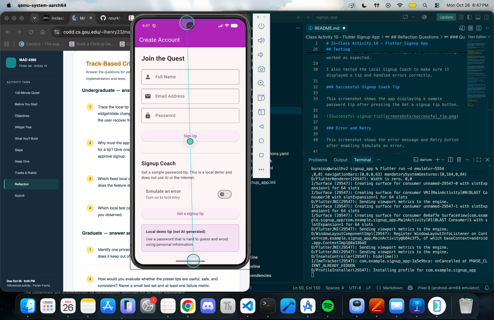
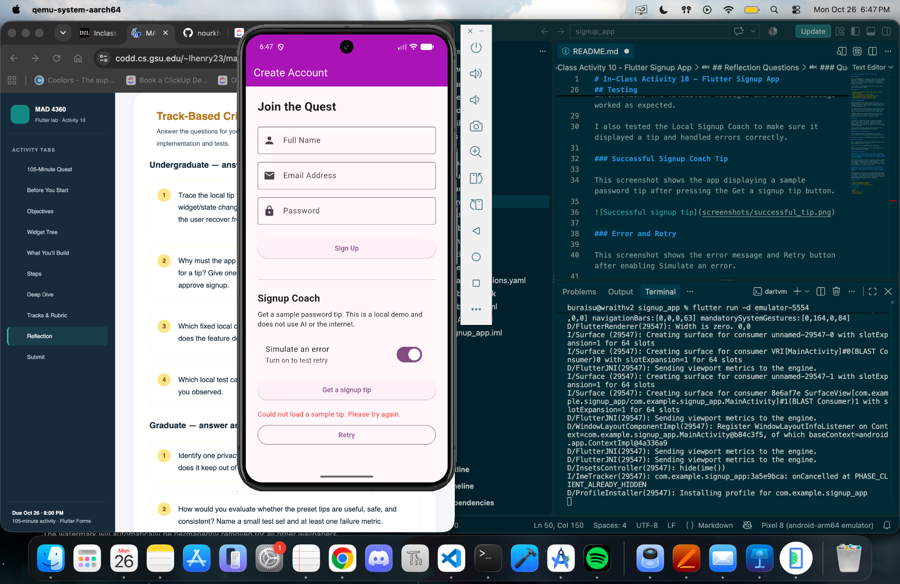

# In-Class Activity 10 - Flutter Signup App

## Description

For this assignment, I created a signup app using Flutter and Dart. The app has a form where users can enter their name, email, and password. It checks the information entered and displays an error message if something is missing or incorrect.

I also added a Local Signup Coach feature that gives users basic password tips.

## Features

- Signup form with name, email, and password fields
- Form validation
- Success message after valid signup
- Local Signup Coach with preset password tips
- Loading indicator when requesting a tip
- Simulated error message and Retry button

## Local Signup Coach

The Signup Coach uses sample password tips that are stored locally in the app. When the user presses the Get a signup tip button, the app shows a loading indicator and then displays a tip.

The feature uses the fixed category `password_help` and does not connect to an actual AI service. It also does not use any information entered into the signup form.

I added a Simulate an error switch to test the error handling. When it is enabled, the app displays an error message and gives the user an option to retry.

## Testing

I tested the signup form using the Android emulator. I tried leaving the fields empty, entering an invalid email, using a short password, and entering valid information. The validation messages and success message worked as expected.

I also tested the Local Signup Coach to make sure it displayed a tip and handled errors correctly.

### Successful Signup Coach Tip

This screenshot shows the app displaying a sample password tip after pressing the Get a signup tip button.

### Error and Retry

This screenshot shows the error message and Retry button after enabling Simulate an error.

After turning off Simulate an error and pressing Retry, the app displayed a tip again.

## Reflection Questions

### Question 1: Trace the local tip feature from button tap to displayed text. Which widget/state changes during simulated loading, and how does the user recover from the local error case?

When I press the Get a signup tip button, the app updates its loading state and shows a loading indicator. After a short delay, it displays one of the preset tips. If an error happens, I can turn off the simulated error switch and press Retry to request another tip.

### Question 2: Why must the app keep form validation local even when it can ask an AI for a tip? Give one example of a bad decision if AI were allowed to approve signup.

Form validation should stay local because the app needs to check the user's information without depending on the tip feature. For example, AI could approve a signup even if the email address was invalid. Keeping these features separate makes the validation more reliable.
## How to Run

1. Open the project in VS Code.
2. Start an Android emulator.
3. Run `flutter run` in the terminal.

## Tools Used

- Flutter
- Dart
- Visual Studio Code
- Android Emulator